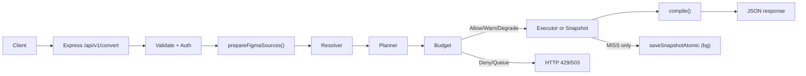
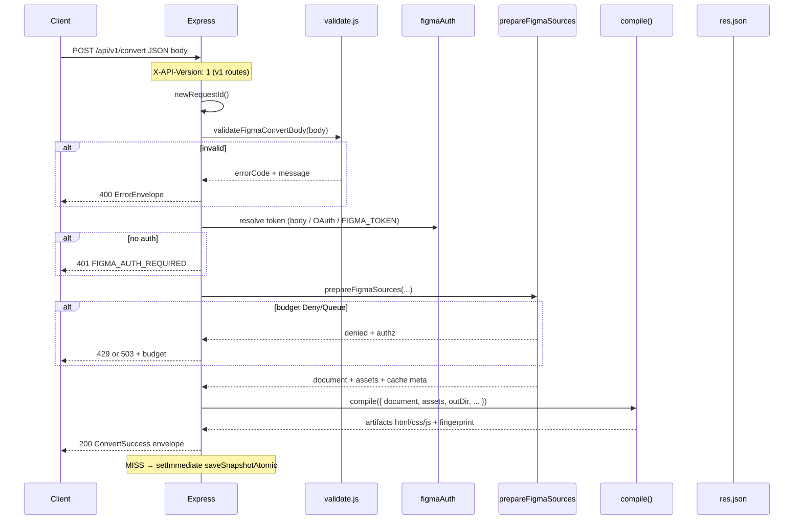
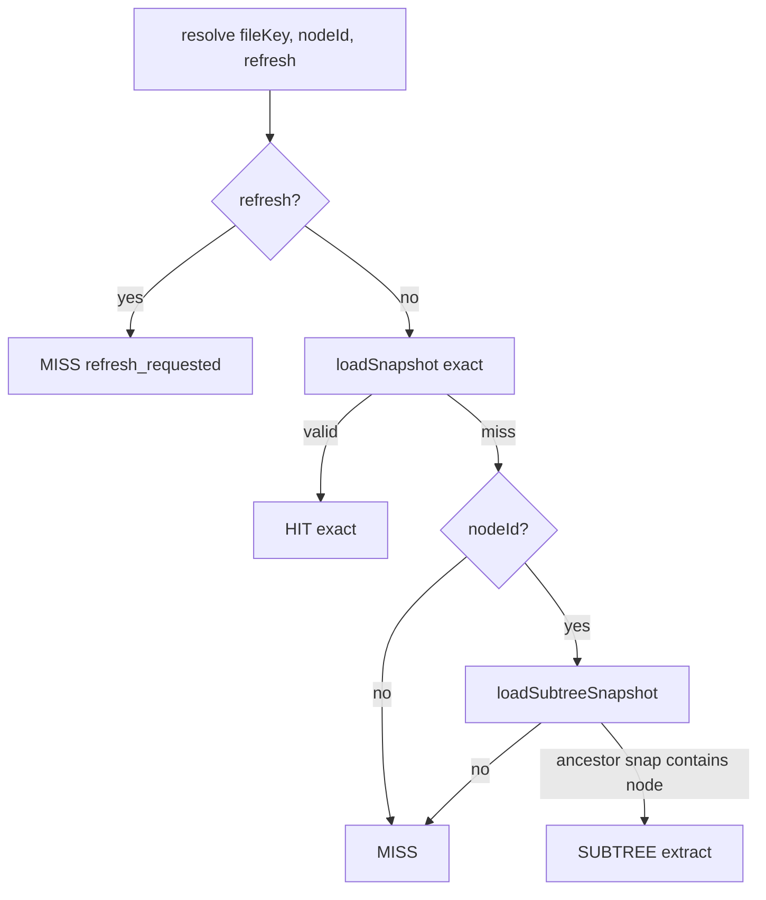
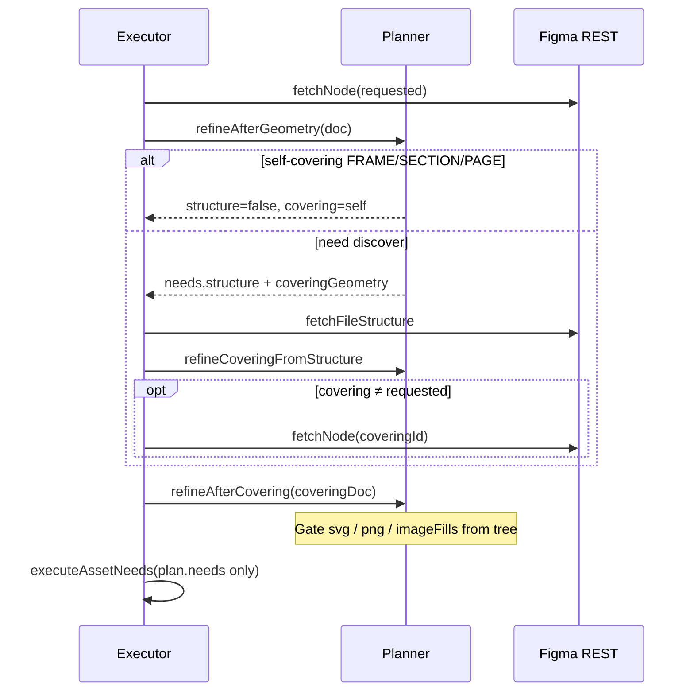
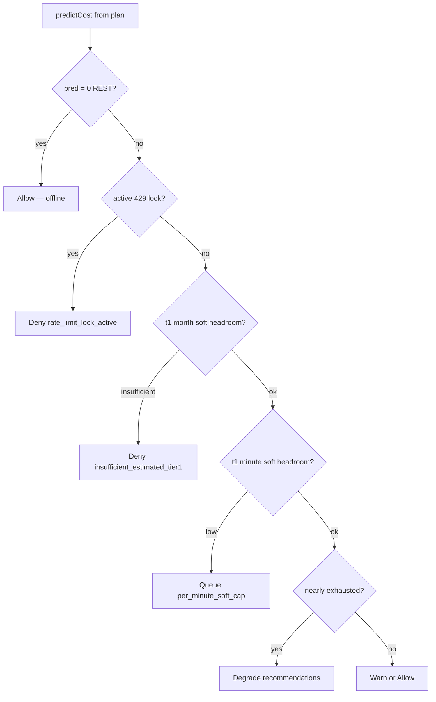
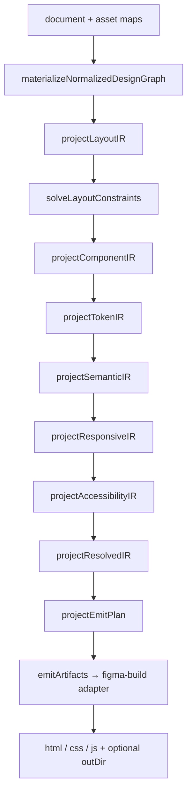
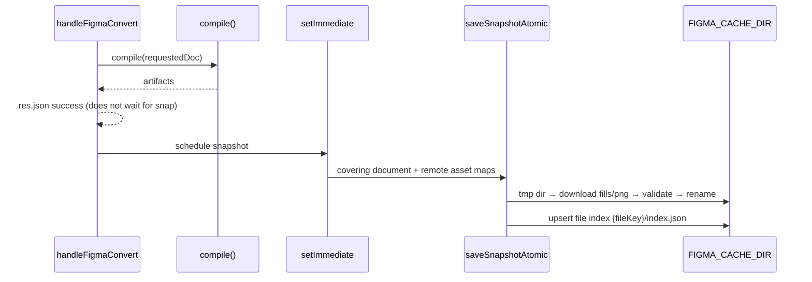
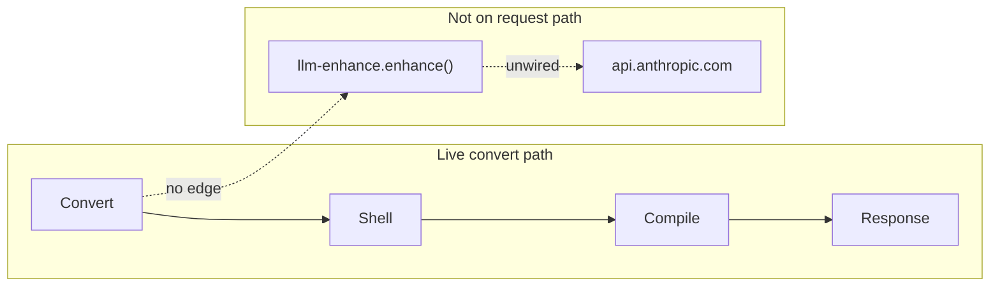
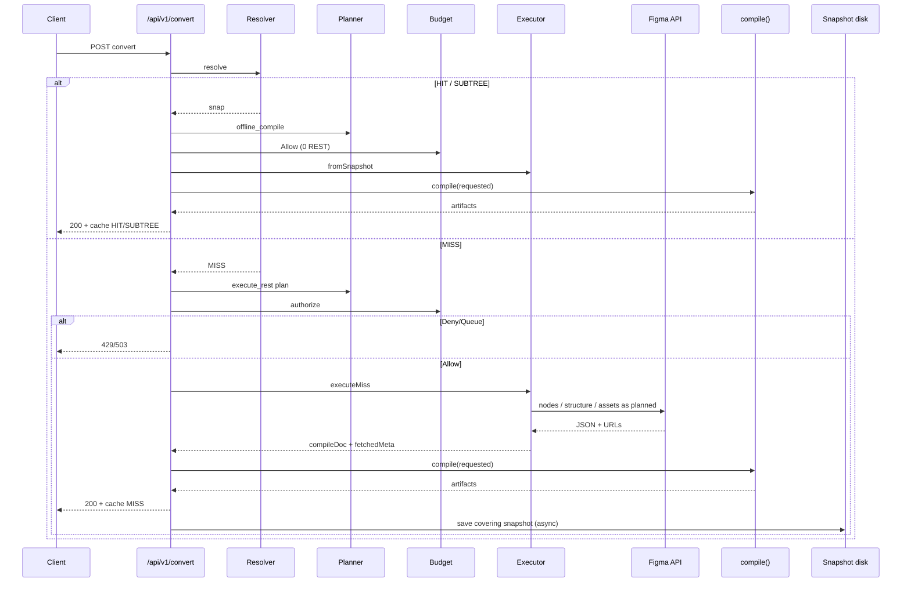

# Request Lifecycle — Complete Current Behavior

| Field | Value |
|-------|--------|
| **Document** | End-to-end request lifecycle (as implemented) |
| **Date** | 2026-07-18 |
| **Scope** | Documentation only — no code changes |
| **Primary path** | Figma convert: `POST /api/v1/convert` ≡ `POST /api/figma/convert` |
| **Authority** | Live code under `server/`, `compiler/` |

---

## 0. Executive summary

A Figma convert request enters Express, is validated, then runs through the **scalability shell** (Resolver → Planner → Budget → Executor) to obtain a design tree + asset maps. HTML/CSS/JS are produced only by the frozen **`compile()`** pipeline. On cache MISS, a covering snapshot is written asynchronously after compile.

**Claude / LLM:** There is **no Google Claude API** in this repository. An optional **Anthropic Claude** helper exists in `server/llm-enhance.js`, but it is **not imported or invoked** by any current HTTP route. The live Figma convert path never calls Claude.



---

## 1. Incoming request flow

### 1.1 Process boot (before any request)

1. `dotenv` loads environment.
2. `runStartupValidation()` (`server/startup.js`):
   - Validates config (`server/config.js`)
   - Ensures output / cache / budget / temp dirs are writable
   - Aligns `FIGMA_CACHE_DIR`, `FIGMA_BUDGET_DIR`, `OUTPUT_DIR`, request timeout env
   - Loads `compiler/compile` (fail-fast if missing)
3. Express listens on `PORT` (default `3001`).
4. Process handlers: `unhandledRejection` (log), `uncaughtException` (log + exit), `SIGTERM`/`SIGINT` (graceful close).

### 1.2 Per-request entry (Figma convert)



**Body fields (convert):** `url` (required), optional `token`, `refresh`, `force`.

**Auth resolution order** (`figmaAuth` in `server/index.js`):

1. Request body `token` (PAT)
2. In-memory OAuth token from Connect Figma
3. `process.env.FIGMA_TOKEN`

---

## 2. Every API endpoint involved

### 2.1 Public / ops (frozen v1 + legacy)

| Method | Path | Role in lifecycle |
|--------|------|-------------------|
| `POST` | `/api/v1/convert` | **Canonical** Figma→HTML convert |
| `POST` | `/api/figma/convert` | Identical handler (legacy alias) |
| `GET` | `/api/v1/health` | Liveness (`status`, `uptime`, cache/budget/compiler ok\|degraded) |
| `GET` | `/health` | Same as above |
| `GET` | `/api/v1/ready` | Readiness (`ready: true` or 503 details) |
| `GET` | `/ready` | Same as above |
| `GET` | `/api/health` | Compat only `{ ok: true }` |

### 2.2 Related product endpoints (not the scalability shell)

| Method | Path | Notes |
|--------|------|--------|
| `POST` | `/api/convert` | **Site** capture (Puppeteer) → `build()` / optional v2 pipeline — not Figma REST |
| `POST` | `/api/figma/plugin` | Plugin posts local tree + images; `compile()` only; no Resolver/Budget |
| `GET` | `/api/figma/status` | `{ connected }` |
| `GET` | `/api/figma/login` | OAuth redirect to Figma |
| `GET` | `/api/figma/callback` | Token exchange; stores access token in memory |
| static | `/preview/<slug>/` | Serves written convert output |

### 2.3 External upstream APIs (during convert MISS)

| Upstream | When |
|----------|------|
| `https://api.figma.com/v1/...` | Executor REST (nodes, file structure, images, fills, SVG) |
| Remote image URLs from Figma | Snapshot download (background) |
| `https://fonts.googleapis.com/...` | Emitted as font `<link>`s in HTML (not an LLM call) |
| Anthropic Claude | **Not called** on current routes (see §10) |

---

## 3. Cache lookup flow

Owned by `server/figma-snapshot.js` + `server/scalability/cache-resolver.js`.

**Location:** `FIGMA_CACHE_DIR` (default `{OUTPUT_DIR}/figma-cache`).  
**Key:** `{fileKey}__{nodeId|root}` directory with `metadata.json`, `document.json`, asset maps, optional local files.



| Result | `cacheStatus` | REST expected |
|--------|---------------|---------------|
| Exact validated snapshot | `HIT` | 0 |
| Covering ancestor + `extractSubtree` | `SUBTREE` | 0 |
| Otherwise / refresh | `MISS` | Planner/Executor may call Figma |

Subtree HIT filters remote asset maps to the extracted subtree before compile.

---

## 4. Resolver flow

**Module:** `server/scalability/cache-resolver.js`  
**Called first** inside `prepareFigmaSources`.

```text
resolve({ fileKey, nodeId, refresh })
  → { hit, cachePath: exact|subtree|none, cacheStatus, cacheReason, snap }
```

Resolver does **not** call Figma. It only reads disk. Executor must treat `snap` as opaque (Exact vs Subtree look the same after load).

---

## 5. Planner flow

**Module:** `server/scalability/planner.js`  
**Rule:** Planner never calls Figma. Executor only executes `needs` flags.

### 5.1 Initial plan (`plan()`)

| Condition | `action` | Typical prediction |
|-----------|----------|-------------------|
| Cache HIT/SUBTREE, not refresh | `offline_compile` | t1=0, t2=0 |
| No `nodeId` (root) | `execute_rest` + `root_frame` | t1≈3, t2≈1 |
| MISS/refresh with `nodeId` | `execute_rest` + `pending_geometry` | t1≈4, t2≈1 |

### 5.2 Refine hooks (MISS only, inside Executor)



`refineAfterCovering` may skip SVG export if local reconstruct succeeds, skip fills if no `imageRef`, skip PNG if none needed.

---

## 6. Budget flow

**Module:** `server/scalability/budget.js` + `budget-state.js`  
**Persists under:** `FIGMA_BUDGET_DIR` (default `{cache}/_budget`).

Budget **never** calls Figma. It only Allow / Warn / Queue / Degrade / Deny.



**HTTP mapping (index.js):**

| Outcome | Executor runs? | HTTP |
|---------|----------------|------|
| Allow / Warn / Degrade | Yes | Continues to compile |
| Deny | No | **429** + `errorCode: BUDGET_DENY` |
| Queue | No | **503** + `errorCode: BUDGET_QUEUE` |

**`force=true`:** Soft Deny/Queue → Warn override (not hard `rate_limit_lock_active`).

**After successful MISS execute:** `budget.recordUsage` increments counters from `restCounter.n` (split into advisory t1/t2).

**On thrown Figma 429:** `budget.recordRateLimit` writes Retry-After lock for later Deny.

---

## 7. Executor flow

**Module:** `server/scalability/executor.js`

### 7.1 Offline path

`fromSnapshot(snap)` → `{ document, name, imageFillUrls, imageUrls, svgFallback, localByUrl }`.

### 7.2 MISS path (`executeMiss`)

1. Fetch geometry (requested node or root).
2. Planner refine covering (structure if needed).
3. Fetch covering geometry if covering ≠ requested.
4. `refineAfterCovering` → asset needs.
5. Conditional REST: SVG markup, image fills map, PNG exports (`figma-fetch.js`).
6. **Compile document** = requested subtree extracted from covering (not the full covering tree).
7. Return `fetchedMeta` with covering document for later snapshot store.

**Important product rule:** Compile uses **requested** node; disk snapshot stores **covering** container for future Subtree HITs.

---

## 8. Compiler flow

**Entry:** `compiler/compile.js` → `compile(options)`.

Called from convert **after** sources are ready. Does not fetch Figma.



Convert passes among others:

- `document`, `graphId`, `policyProfileId: 'pixel-faithful'`
- `outDir`, `slug`, `title`
- `imageUrls`, `imageFillUrls`, `svgMarkup`, `fonts`, `localByUrl`
- `downloadImages: true`, `useCache: !refresh`

Return includes `artifacts`, `steps`, `timings`, `fingerprint` (checksums). Index maps these into the HTTP success body.

**Plugin path** also calls `compile()` but skips Resolver/Planner/Budget/Executor.

---

## 9. Snapshot flow

**Write path:** only when `cacheStatus === 'MISS'` and `fetchedMeta` present, **after** successful `compile()`, via `setImmediate` → `saveSnapshotAtomic` (`server/figma-snapshot.js`).



Atomicity: write under `{final}.tmp-*`, validate completeness, rename into place; failures do not block the HTTP success already sent.

**Read path:** Resolver Exact / Subtree (see §3–§4).

---

## 10. Exactly where Google Claude / Claude API is invoked

### 10.1 Clarification (current truth)

| Claim | Reality in this repo |
|-------|----------------------|
| “Google Claude API” | **Does not exist.** Claude is an **Anthropic** product. |
| Google APIs used | **Google Fonts** URLs may appear in emitted HTML CSS links — not generative AI. |
| Claude invocation on convert | **None.** |

### 10.2 Where Claude *would* be invoked (dormant module)

**File:** `server/llm-enhance.js`  
**Function:** `enhance({ html, css })`  
**HTTP:** `POST https://api.anthropic.com/v1/messages`  
**Auth header:** `x-api-key: ANTHROPIC_API_KEY`  
**Model:** `process.env.ANTHROPIC_MODEL` or default `claude-sonnet-5`

**Wiring status:** No `require('./llm-enhance')` (or equivalent) exists in `server/index.js`, client, or scalability shell. Env keys in `.env.example` document an optional “Refine with Claude” UI concept, but the live UI/routes do not call this module today.



---

## 11. What payload is sent to Claude

*Only if `enhance()` were called.* Current code constructs:

**Endpoint:** `https://api.anthropic.com/v1/messages`

**Headers:**

- `content-type: application/json`
- `x-api-key: <ANTHROPIC_API_KEY>`
- `anthropic-version: 2023-06-01`

**JSON body:**

```json
{
  "model": "<ANTHROPIC_MODEL or claude-sonnet-5>",
  "max_tokens": 8000,
  "system": "<senior front-end engineer instructions; respond ONLY with JSON {html, css}>",
  "messages": [
    {
      "role": "user",
      "content": "HTML:\n\n<html...>\n\nCSS:\n\n<css...>"
    }
  ]
}
```

System prompt instructs: clearer class names, DRY CSS, keep `:root` tokens, keep image placeholders and `styles.css` link, no invented content, **JSON only** — no markdown fences.

---

## 12. What response Claude returns

Anthropic Messages API shape (as consumed by `llm-enhance.js`):

```json
{
  "content": [
    { "type": "text", "text": "{\"html\": \"...\", \"css\": \"...\"}" }
  ]
}
```

Code path:

1. Concatenate all `content[]` blocks with `type === 'text'`.
2. Strip ``` / ```json fences if present.
3. `JSON.parse` → require `parsed.html` and `parsed.css`.
4. On parse failure or missing fields → throw `Could not parse enhancement response as JSON.`
5. On non-OK HTTP → throw `Anthropic API error <status>: …` (body truncated to 300 chars).

---

## 13. How Claude output is merged back into the pipeline

**Current live pipeline:** **N/A — Claude output is never merged** because `enhance()` is never called.

**Intended merge (if wired as the module comments describe):**

1. Deterministic convert produces `html` + `css`.
2. `enhance({ html, css })` returns `{ html, css }`.
3. Caller would replace response/disk artifacts with the returned pair.

No merge logic exists in `handleFigmaConvert`, plugin convert, or `/api/convert` today.

---

## 14. Error handling and retry flow

### 14.1 Validation / auth (before shell)

| Condition | Status | `errorCode` (typical) |
|-----------|--------|------------------------|
| Bad JSON body | 400 | `INVALID_JSON` |
| Invalid Figma URL / node / flags | 400 | `INVALID_*` |
| No Figma token | 401 | `FIGMA_AUTH_REQUIRED` |

### 14.2 Budget block (no Executor)

| Outcome | Status | Envelope |
|---------|--------|----------|
| Deny | 429 | `BUDGET_DENY` + `budget` + `cache` |
| Queue | 503 | `BUDGET_QUEUE` + `budget` + `cache` |

No automatic client retry from server; clients should honor `budget.retryAfter` when present.

### 14.3 Figma REST retries (`figmaGet`)

```mermaid
sequenceDiagram
  participant E as Executor
  participant G as figmaGet
  participant F as api.figma.com

  loop up to 4 attempts
    E->>G: request
    G->>F: fetch + AbortController timeout
    alt network/timeout
      G->>G: sleep backoff; retry
    else 429 and Retry-After ≤ 30s
      G->>G: sleep Retry-After; retry
    else 429 hard
      G-->>E: throw status=429 (+ plan tier headers)
    else other 4xx/5xx
      G-->>E: throw status=N
    else 200
      G-->>E: JSON (+ restCounter++)
    end
  end
```

Timeout: `REQUEST_TIMEOUT` / `FIGMA_REQUEST_TIMEOUT_MS` (default 30s).

### 14.4 Convert catch path

1. Log `convert_error` (stacks only in development console).
2. If `err.status === 429` → `budget.recordRateLimit` + include `budget` in response.
3. Map status: 401/403 → 401; other 4xx/5xx preserved; else 500.
4. Body: ErrorEnvelope (`errorCode`, `message`, `error`, `requestId`, optional `stage`/`fileKey`/`nodeId`/`budget`).
5. **Never** return stack traces to the client.

### 14.5 Snapshot / covering soft failures

- Covering discovery failure → warn, fall back to requested node only; convert may still succeed.
- Background snapshot failure → logged; client already received 200.
- Corrupt budget JSON → quarantine + recover (budget-state); startup/ready check dirs writable.

### 14.6 Site convert (`/api/convert`) note

Separate lifecycle: Puppeteer capture → `build()` (or gated v2). Optional `LOVABLE_VAR_COMPLETION` enhancer is local CSS var repair — **not** Claude.

---

## 15. Final response generation

### 15.1 Success `200`

Built via `successEnvelope` / direct fields in `handleFigmaConvert`:

| Field | Source |
|-------|--------|
| `ok: true` | Envelope |
| `requestId` | Per-request id |
| `html`, `css`, `scripts['script.js']` | `compiled.artifacts` |
| `sections`, `sectionsSummary` | artifacts |
| `source: "figma-compiler"` | Constant |
| `cache` | `{ status, reason, restCalls, compileMs }` |
| `compiler` | graphId, steps, fingerprint, timings |
| `output` | dir, slug, assets |
| `previewUrl` | `/preview/{slug}/` |
| `budget` | `budget.toApiBudget(authz)` |

### 15.2 Error envelopes

Always: `ok: false`, `errorCode`, `message`, `error` (alias of message), `requestId`.  
Budget errors also include `stage`, `fileKey`, `nodeId`, `cache`, `budget`.

### 15.3 End-to-end sequence (HIT vs MISS)



---

## Appendix A — Module map

| Concern | Module |
|---------|--------|
| HTTP convert | `server/index.js` (`handleFigmaConvert`) |
| Validation / errors | `server/security/validate.js`, `errors.js`, `api/v1/envelope.js` |
| Orchestration | `server/scalability/index.js` |
| Resolver | `server/scalability/cache-resolver.js` |
| Planner | `server/scalability/planner.js` |
| Covering selection | `server/scalability/covering.js` |
| Budget | `server/scalability/budget.js`, `budget-state.js` |
| Executor | `server/scalability/executor.js` |
| Figma REST | `server/figma-fetch.js` |
| Snapshots | `server/figma-snapshot.js` |
| Analyze / emit adapter | `server/figma-build.js`, `compiler/artifacts` |
| Compiler | `compiler/compile.js` + kernel engines |
| Claude (unused) | `server/llm-enhance.js` |

---

## Appendix B — Explicit non-invocations on Figma convert

- Redis / CDN / distributed locks  
- Product Modes  
- Anthropic Claude / any Google generative API  
- Planner/Budget changes mid-request beyond documented refine + authorize  
- Client-visible stack traces  

---

**End of document.** Documentation only; no implementation implied.
